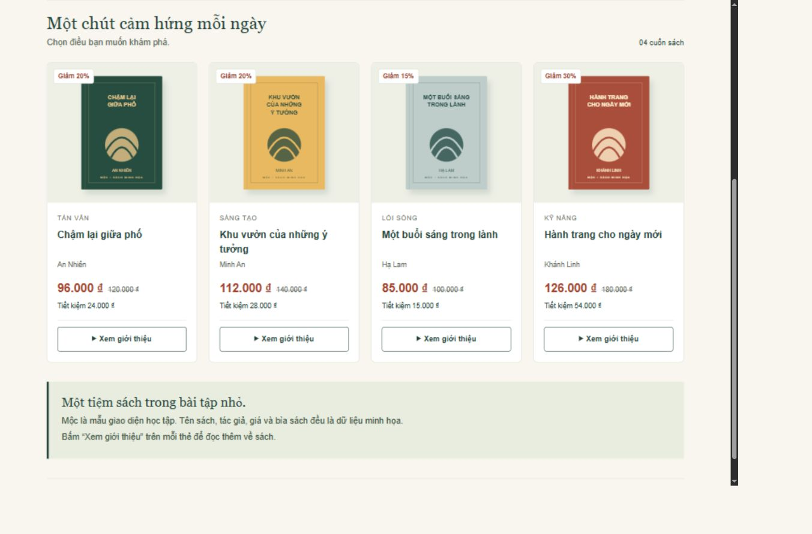
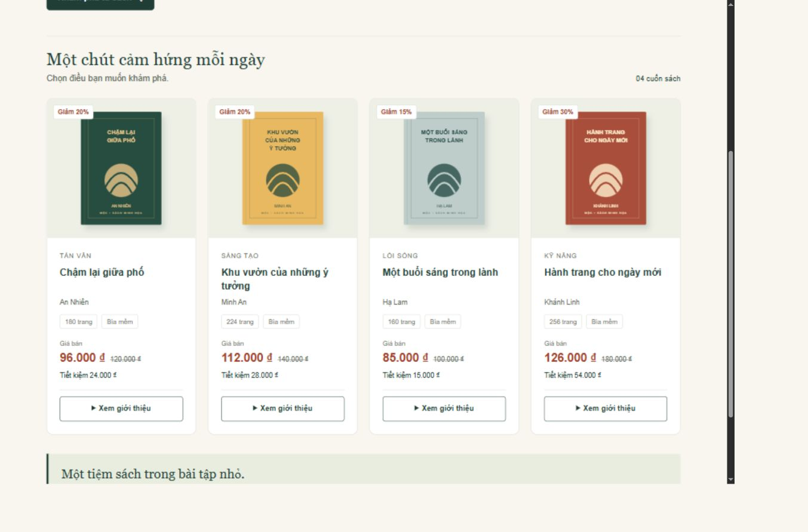
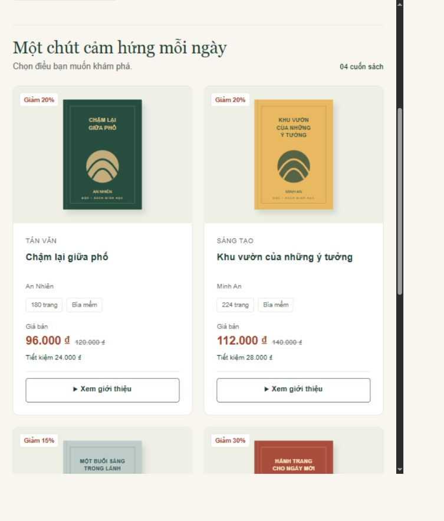
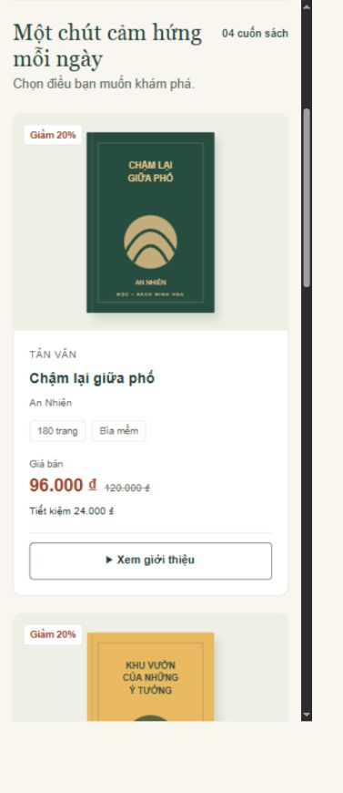
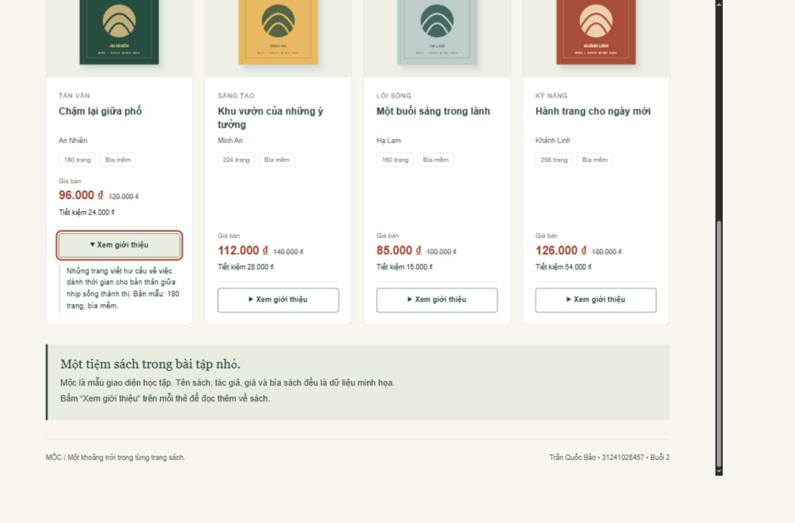

# Bài tập cá nhân Buổi 2 - HTML5 và CSS3

**Sinh viên:** Trần Quốc Bảo  
**MSSV:** 31241028457  
**Ngày thực hiện:** 04/11/2026  
**Sản phẩm:** Nhà sách Mộc, tiếp tục từ Buổi 1  
**Repository:** https://github.com/baotranuehsg-netizen/ecommerce-ui-improvement

## 1. Rà soát sản phẩm cũ và phạm vi cải tiến

Phiên bản gốc được lấy trực tiếp từ repository Buổi 1, commit `d8a2aa0` (Add four original SVG book covers). Không tạo website mới. Giữ lại thương hiệu Mộc, bốn cuốn sách, hình SVG, giá bán, nội dung giới thiệu và cấu trúc một trang. Khu vực trọng tâm là thẻ sản phẩm; menu được chỉnh nhỏ để thực hành danh sách và Flexbox.

Bản cũ đã có `header`, `nav`, `main`, `section`, `article`, `aside`, `footer`, tiêu đề đúng thứ bậc, ảnh có alt, CSS riêng và lưới responsive.

| Vấn đề/cơ hội cải thiện đã xác định | Hướng xử lý | Kết quả mong muốn |
| --- | --- | --- |
| Số trang và loại bìa nằm trong mô tả đóng, phải mở từng sách mới thấy. | Đưa thông tin sẵn có lên `ul.book-specs` ở mỗi thẻ. | So sánh ấn bản ngay trong danh sách. |
| Menu là các liên kết đặt trực tiếp trong nav, chưa biểu diễn quan hệ danh sách. Đây là cải thiện ngữ nghĩa, không phải HTML sai. | Bọc liên kết bằng `ul.nav-list > li`; dùng Flexbox trên ul. | Cấu trúc dễ hiểu và khoảng cách menu rõ ràng. |
| Nút đổi màu tức thời, `transition-duration` của bản gốc là 0s. | Thêm transition màu 0,2 giây; tôn trọng prefers-reduced-motion. | Phản hồi nhẹ khi người dùng không bật giảm chuyển động. |
| Thẻ cần thêm chỗ cho thông tin ấn bản. | Tăng padding phần thân từ 19 lên 24 px; dùng 20 px trên mobile, bo góc 12 px. | Nội dung có khoảng thở, giữ được vùng bấm rõ ràng. |

## 2. HTML5 có ngữ nghĩa

- `nav` chứa nhóm liên kết điều hướng đến Tủ sách và Về Mộc.
- `ul/li` biểu diễn menu và các thông số cùng cấp của một cuốn sách.
- `section` nhóm toàn bộ danh sách sách và có tiêu đề h2.
- `article` biểu diễn từng thẻ có tên riêng qua h3 và `aria-labelledby`.
- `details/summary` mở/đóng giới thiệu ngay trên trang, không cần JavaScript.
- `img` có alt mô tả bìa sách. Hai ảnh trang trí ở banner có alt rỗng và nằm trong vùng `aria-hidden` để tránh đọc lặp.
- `a` được dùng cho điều hướng; `summary` dùng cho thao tác mở/đóng, không biến liên kết thành nút giả.

Thứ bậc giữ nguyên: h1 là thông điệp chính; h2 cho danh sách và phần giới thiệu; h3 là tên sách. HTML được xuống dòng để dễ tìm và sửa. Không thêm backend, đăng nhập hoặc thanh toán.

## 3. CSS ngoài, selector và Box Model

HTML liên kết `<link rel="stylesheet" href="css/style.css">`. Tất cả ảnh dùng đường dẫn tương đối `images/...svg`, phù hợp chạy từ file hoặc dưới thư mục dự án trên GitHub Pages.

| Loại selector | Ví dụ trong mã | Tác dụng |
| --- | --- | --- |
| Element | `body`, `img` | Đặt font, nền, hoặc giới hạn ảnh. |
| Class | `.card-body`, `.book-specs` | Định dạng một nhóm thành phần có cùng vai trò. |
| Descendant | `.book-specs li`, `.card summary` | Chỉ áp dụng cho phần tử nằm trong vùng được chỉ định. |
| Pseudo-class | `.card summary:hover`, `:focus-visible` | Phản hồi khi dùng chuột hoặc bàn phím. |
| Attribute | `.card details[open] summary` | Đổi nền khi giới thiệu đang mở. |

Box Model cụ thể: `.card-body` có padding 24 px (20 px trên mobile), là khoảng trống bên trong vùng nội dung. `.book-specs` có `margin: 0 0 18px`, tạo khoảng cách bên ngoài phía dưới danh sách thông số. `.card` có border 1 px và border-radius 12 px. `box-sizing: border-box` làm kích thước khai báo bao gồm cả padding và border, giúp tránh cộng kích thước ngoài dự kiến.

Không dùng margin để thay thế gap của lưới. Khoảng cách giữa các thẻ vẫn do `.products { gap: 22px; }` quản lý. Nhãn giá bán được bổ sung bằng chữ, không chỉ dùng màu để phân biệt.

## 4. Flexbox và Grid

### Flexbox

`.nav-list` dùng `display: flex`, `justify-content: flex-end`, `align-items: center`, `gap: 16px` và `flex-wrap: wrap`. Phần tử cha là ul; phần tử con trực tiếp là li. Các mục menu được căn về cuối trục ngang, cân giữa theo trục dọc và cách nhau bằng gap. Header vẫn dùng `justify-content: space-between` để tách thương hiệu và menu.

`.book-specs` cũng dùng Flexbox để hai thông số cùng hàng và tự xuống dòng khi thiếu chỗ. `.price` căn giá bằng `align-items: baseline` để giá lớn và giá gạch ngang có cùng đường cơ sở chữ.

So sánh cần hiểu: `flex-start` dồn các mục về đầu, `center` dồn cả nhóm vào giữa, `space-between` đưa mục đầu/cuối về hai mép và phân phối phần trống giữa các mục. Hiệu quả chỉ rõ khi phần tử cha có không gian dư; không phải thay giá trị lúc nào cũng tạo thay đổi lớn. Đây là giải thích cơ chế, không giả định đã thực hiện thử nghiệm người dùng.

### Grid

Lưới sản phẩm kế thừa `display: grid; grid-template-columns: repeat(4, minmax(0, 1fr)); gap: 22px`. Dưới 960 px chuyển hai cột; dưới 600 px chuyển một cột. `repeat` lặp cấu hình cột; `1fr` chia phần không gian còn lại; giá trị tối thiểu 0 cho phép cột co lại với nội dung dài.

Ảnh dùng `object-fit: contain` để giữ đủ bìa và không làm méo. `cover` cũng giữ tỷ lệ nhưng có thể cắt mép ảnh để phủ kín khung, nên không phù hợp mục tiêu đọc trọn bìa ở đây. Không thay contain bằng cover chỉ vì ví dụ trong đề dùng cover.

## 5. Hover, focus và kiểm tra

Nút giới thiệu đổi nền sang xanh đậm và chữ trắng khi hover. Focus bàn phím có outline màu nâu đỏ 3 px, offset 3 px. Transition chỉ áp dụng màu nền/chữ, không làm xê dịch bố cục. Khi `prefers-reduced-motion: reduce`, transition được tắt theo thiết lập người dùng.

### Bảng kiểm thử

| Nội dung | Kết quả | Bằng chứng/giới hạn |
| --- | --- | --- |
| HTML mở được | Đạt | Mở qua HTTP cục bộ; vẫn là HTML tĩnh. |
| CSS được áp dụng | Đạt | Padding thân thẻ đo được 24 px desktop, 20 px mobile. |
| Hình ảnh | Đạt | Tất cả ảnh tải xong, naturalWidth > 0; bốn bìa giữ tỷ lệ. |
| Liên kết | Đạt | Tủ sách cuộn tới `#san-pham`; các đích nội trang tồn tại. |
| Bố cục desktop | Đạt | innerWidth 1366 px, 4 cột; scrollWidth bằng clientWidth, không tràn ngang. |
| Bố cục tablet | Đạt | Kiểm tra quanh 768 px: innerWidth 767 và 769 px, đều 2 cột, không tràn ngang. Sai khác do mức thu phóng và làm tròn viewport của môi trường. |
| Bố cục mobile | Đạt | innerWidth 390 px, 1 cột; không tràn ngang. |
| Hover | Đạt | `:hover` true; màu nền đo được rgb(32,62,53), chữ trắng. |
| Focus và bàn phím | Đạt | Tab/Shift+Tab đưa focus về summary; `:focus-visible` true; Enter đóng giới thiệu. |
| Transition | Có cấu hình | CSS khai báo 0,2s; môi trường đang bật giảm chuyển động nên computed duration là 0s đúng theo media query. Chưa kiểm tra hoạt ảnh ở môi trường tắt tùy chọn này. |
| Chỉnh sửa độc lập | Cần bổ sung | Ghi thuộc tính đã sửa, lý do và kết quả sau khi tự thực hành. |

### Vấn đề, nguyên nhân và cách khắc phục

1. **Thông số khó so sánh:** nằm trong `details` đóng. Đưa đúng dữ liệu đã có ra danh sách thông số, kiểm tra khớp với mô tả từng sách.
2. **Khoảng cách menu sau khi thêm ul:** kiểu danh sách mặc định có dấu đầu dòng, margin/padding. Dùng `list-style: none; margin: 0; padding: 0` và chuyển Flexbox sang `.nav-list`.
3. **Tương tác trạng thái mở và hover:** nền sáng của `details[open] summary` có thể ghi đè nền hover trong khi chữ vẫn trắng. Thêm quy tắc cụ thể `details[open] summary:hover` với nền xanh, chữ trắng; kiểm tra trạng thái vừa mở vừa hover cho thấy màu đúng.

Phạm vi hỗ trợ và phần tự thực hành được ghi tại [AI_USAGE.md](AI_USAGE.md).

## 6. Ảnh minh chứng

Cặp ảnh được chụp từ bản trước commit `d8a2aa0` và bản sau tại cùng viewport mục tiêu desktop, cùng vùng danh sách. Ảnh không được dựng lại bằng công cụ tạo ảnh.

### Trước cải tiến

### Sau cải tiến - khu vực sản phẩm

### Tablet và mobile

### Focus bàn phím

## 7. Trả lời bảy câu hỏi kiến thức

**Câu 1. Những phần tử HTML5 đã dùng và lý do?**  
Trong vùng trọng tâm, section nhóm danh sách, article là từng cuốn sách, h2/h3 đặt tiêu đề theo cấp, img và alt mô tả bìa, ul/li nhóm thông số. details/summary mở nội dung giới thiệu. Header, nav, main và footer tổ chức các vùng lớn của trang. Dùng theo vai trò nội dung, không thêm thẻ chỉ để đủ tên.

**Câu 2. Margin khác padding thế nào?**  
Padding nằm giữa nội dung và viền; ví dụ padding 24 px của card-body giữ chữ cách mép thẻ. Margin là khoảng ngoài phần tử; margin-bottom 18 px của book-specs tách danh sách thông số khỏi phần giá. Border nằm bao quanh vùng padding/nội dung. Các thuộc tính này không thay thế nhau.

**Câu 3. Flexbox được dùng ở đâu?**  
Menu nav-list, nhóm thông số book-specs, nhóm giá price và bố cục trong card-body dùng Flexbox. Với menu theo hàng, justify-content điều khiển phân phối trên trục ngang; align-items căn các mục theo trục dọc. Trong card-body có flex-direction: column thì trục chính đổi thành dọc. Header dùng space-between để thương hiệu và menu về hai phía.

**Câu 4. Grid khác Flexbox thế nào, vì sao chọn Grid?**  
Flexbox tập trung bố trí một chiều theo hàng hoặc cột, phù hợp menu/nhóm giá. Grid định nghĩa các cột và hàng cho toàn vùng, phù hợp bốn thẻ cần chia cột đều và đổi số cột ở breakpoint. Bản này kết hợp Grid bên ngoài, Flexbox bên trong thẻ.

**Câu 5. Xóa display:grid thì sao?**  
Nếu không có quy tắc khác thay thế, div.products trở về bố cục block bình thường; các article thường xếp dọc và chiếm bề rộng khả dụng. grid-template-columns không còn tác dụng tạo cột, gap cũng không còn tạo khoảng cách như một grid container. Flexbox bên trong mỗi card vẫn hoạt động vì đó là quy tắc khác.

**Câu 6. Vì sao ảnh cần alt?**  
Alt cung cấp nội dung thay thế khi không xem được ảnh hoặc sử dụng trình đọc màn hình. Ví dụ ảnh sản phẩm có alt “Bìa minh họa sách Chậm lại giữa phố”, mô tả đúng ảnh. Ảnh chỉ trang trí ở hero có alt rỗng nhằm tránh lặp thông tin.

**Câu 7. Một đề xuất AI đã kiểm tra/điều chỉnh?**  
Đề xuất tăng padding của AI được áp dụng 24 px trên desktop và điều chỉnh 20 px trên mobile để tiết kiệm không gian. Công cụ đo CSS xác nhận hai giá trị; lưới không tràn ngang ở kích thước đã thử.

## 8. Chuẩn bị sửa mã trực tiếp

| Yêu cầu | Vị trí cần sửa | Dự đoán |
| --- | --- | --- |
| Đổi khoảng bên trong thẻ | `.card-body { padding: ... }` và quy tắc mobile | Tăng padding làm phần chữ hẹp hơn, có thể xuống thêm dòng. |
| Đổi màu giá | `.price strong { color: ... }` | Chỉ đổi giá bán, không đổi toàn bộ trang; cần giữ độ tương phản. |
| Đổi số cột | `.products { grid-template-columns: repeat(..., minmax(0,1fr)) }` | Tăng cột làm mỗi thẻ hẹp hơn; lưu ý các media query ghi đè. |
| Đổi khoảng cách menu | `.nav-list { gap: ... }` | Khoảng giữa li thay đổi; mobile có gap riêng 6 px. |
| Sửa alt | Thuộc tính alt của img trong card tương ứng | Đổi mô tả thay thế, không đổi ảnh đang hiển thị. |

## 9. Đường dẫn và giới hạn

- Mã nguồn: https://github.com/baotranuehsg-netizen/ecommerce-ui-improvement
- Website: https://baotranuehsg-netizen.github.io/ecommerce-ui-improvement/
- Nhật ký AI: [AI_USAGE.md](AI_USAGE.md).
- Bài Buổi 1 được giữ trong BAO_CAO.md, KIEM_TRA.md và lịch sử Git.

Nộp URL repository và website theo kênh giảng viên yêu cầu.
