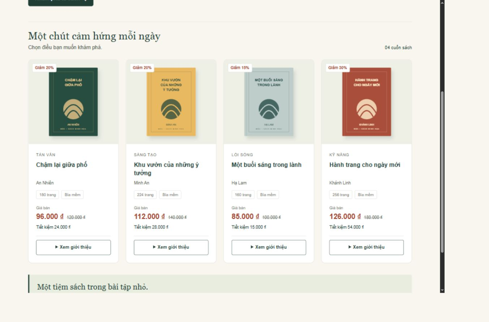

# Mộc - Bài tập cá nhân HTML5/CSS3

**Trần Quốc Bảo - MSSV 31241028457**

## Bài Buổi 2

Tiếp tục website Buổi 1 trong cùng repository. Trọng tâm: thẻ sách, danh sách thông số và menu điều hướng. Giữ bốn sản phẩm, giá và bìa SVG tự tạo; không dùng framework, backend hoặc JavaScript.

- [Báo cáo Buổi 2: phân tích, kiểm thử, ảnh và 7 câu trả lời](BAO_CAO_BUOI2.md)
- [Ghi nhận sử dụng AI](AI_USAGE.md)
- [Báo cáo Buổi 1](BAO_CAO.md)
- [Mã nguồn công khai](https://github.com/baotranuehsg-netizen/ecommerce-ui-improvement)
- [Website chạy trực tiếp](https://baotranuehsg-netizen.github.io/ecommerce-ui-improvement/)

## Website tham khảo

[Vinabook](https://www.vinabook.com/). Khảo sát Buổi 1 gồm trang chủ, danh mục, chi tiết, tìm kiếm và giỏ hàng. Mộc là thiết kế minh họa riêng, không sao chép mã hoặc bìa sách Vinabook. Tên sách, tác giả và giá là dữ liệu hư cấu.

## Thay đổi Buổi 2

1. Dùng ul/li cho menu và thông tin ấn bản; đưa số trang, bìa sách ra ngoài mô tả đóng.
2. Tăng padding thân thẻ từ 19 lên 24 px, dùng 20 px trên mobile; bo góc 12 px.
3. Thực hành element/class/descendant selector, margin, padding và border-box.
4. Dùng Flexbox cho menu, thông số và giá; giữ Grid 4/2/1 cột đã có.
5. Thêm transition màu 0,2s, hover rõ ràng và focus-visible; tắt chuyển động nếu hệ điều hành yêu cầu giảm chuyển động.
6. Định dạng lại mã để dễ đọc và sửa trực tiếp.

## Cách chạy

Tải hoặc clone repository; mở `index.html` bằng trình duyệt. Giữ nguyên các thư mục `css`, `images`. Không cần cài thư viện hoặc build.

```text
index.html
css/style.css
images/                 # 4 bìa SVG kế thừa
screenshots/            # ảnh trước, sau và focus Buổi 2
README.md
BAO_CAO_BUOI2.md
AI_USAGE.md
BAO_CAO.md              # báo cáo Buổi 1
KIEM_TRA.md             # kiểm tra Buổi 1
```

## Kiểm tra

Đã kiểm tra bằng trình duyệt ở desktop 1366 px, mobile 390 px và hai độ rộng 767/769 px quanh mốc tablet 768 px do làm tròn mức thu phóng. Ảnh hiển thị, không tràn ngang; click mở mô tả, Tab/Shift+Tab hiển thị focus, Enter đóng mô tả.



## Sử dụng AI

Các hỗ trợ về phân tích, mã nguồn, kiểm tra và giải thích kỹ thuật được ghi gọn trong [AI_USAGE.md](AI_USAGE.md). Không có chức năng mua hàng hay thanh toán thật.
